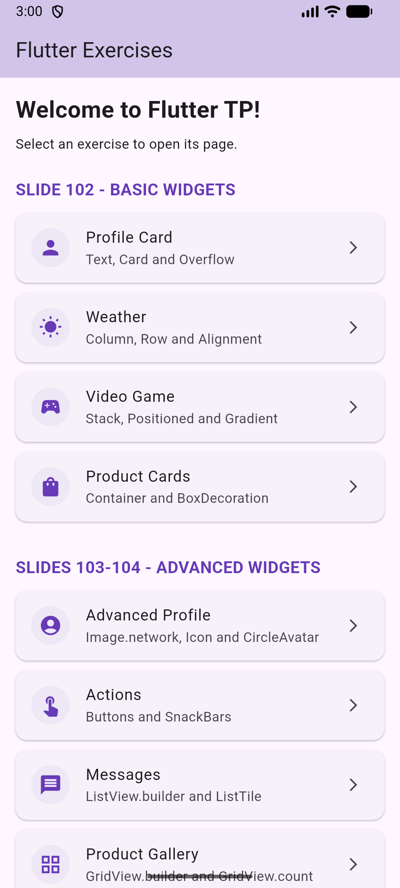
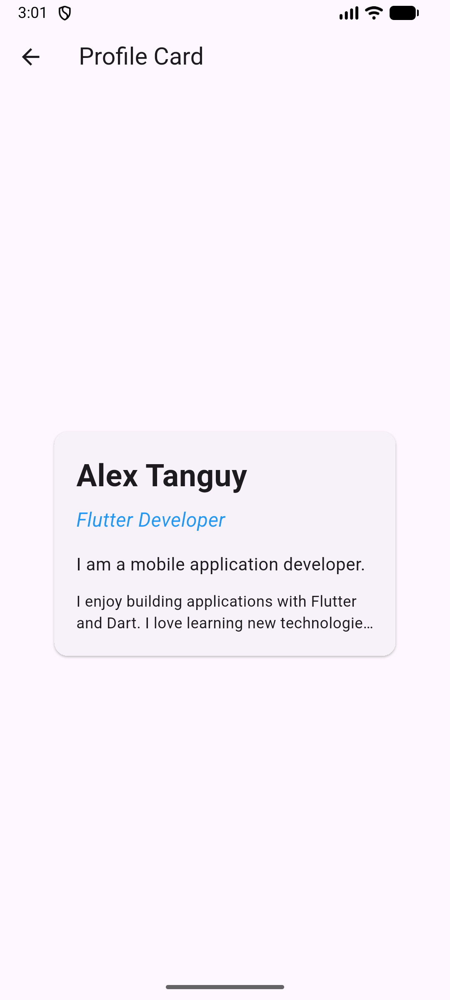
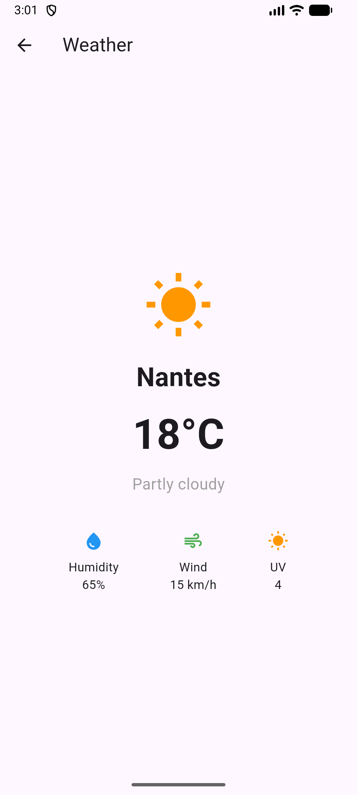
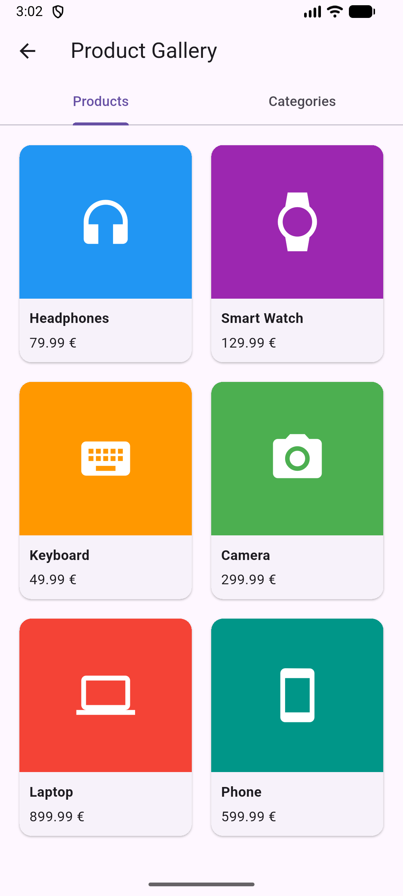

# TP Flutter – Introduction à Dart et aux widgets

Application Flutter réalisée dans le cadre du cours de développement mobile à l'ESGI Nantes (2026).

Ce projet regroupe des exercices pratiques pour apprendre à construire des interfaces avec Flutter, organiser des widgets, gérer des interactions et valider un formulaire. Un menu principal permet d'accéder aux différents écrans sans modifier le point d'entrée de l'application.

## Aperçu de l'application

| Accueil | Profil |
|---|---|
|  |  |

| Météo | Galerie de produits |
|---|---|
|  |  |
## Exercices réalisés

### Slide 102 – Widgets de base

| Écran | Notions abordées |
|---|---|
| **Profil** | `Text`, `TextStyle`, `Card`, `maxLines`, `TextOverflow.ellipsis` |
| **Météo** | `Row`, `Column`, `MainAxisAlignment`, `CrossAxisAlignment` |
| **Jeu vidéo** | `Stack`, `Positioned`, dégradé et superposition d'éléments |
| **Cartes produits** | `Container`, `BoxDecoration`, bordures, coins arrondis et ombres |

### Slide 103 – Widgets avancés

| Écran | Notions abordées |
|---|---|
| **Profil avancé** | `Image.network`, chargement de l'image, `Icon`, `CircleAvatar` |
| **Actions** | `ElevatedButton`, `TextButton`, `OutlinedButton`, `IconButton`, `FloatingActionButton`, `SnackBar` |
| **Messages** | `ListView.builder`, `ListView.separated`, `ListTile`, `Divider` |
| **Galerie** | `GridView.builder`, `GridView.count`, affichage en colonnes |

### Slide 104 – Formulaire

L'écran d'inscription permet de :

- saisir un nom d'utilisateur, une adresse e-mail et un mot de passe ;
- vérifier les champs avec `Form`, `TextFormField` et `validator` ;
- afficher ou masquer le mot de passe ;
- afficher des erreurs de saisie et un message de confirmation avec `SnackBar`.

La validation est locale : ce TP ne crée pas de compte utilisateur sur un serveur.

### Autre exercice – Préférences

Une page de préférences permet de tester un interrupteur de notifications, un sélecteur de date, une boîte de dialogue de confirmation et un indicateur de chargement.

## Technologies utilisées

- **Dart** : langage de programmation.
- **Flutter** : création des interfaces mobiles.
- **Material Design** : composants d'interface.
- **Android Studio** et **émulateur Android** : développement et tests.
- **Git et GitHub** : suivi des modifications du projet.

## Organisation du projet

```text
flutter_tp/
├── assets/
│   ├── fonts/                  # Polices OpenSans
│   └── images/                 # Images locales
├── lib/
│   ├── main.dart               # Démarrage de l'application
│   └── widgets/                # Écrans des différents exercices
│       ├── exercises_home_page.dart
│       ├── profile_page.dart
│       ├── weather_page.dart
│       ├── game_page.dart
│       ├── products_page.dart
│       ├── advanced_profile_page.dart
│       ├── actions_page.dart
│       ├── messages_page.dart
│       ├── gallery_page.dart
│       ├── registration_page.dart
│       └── home_page.dart      # Préférences
├── screenshots/
│   ├── Home.png
│   ├── Profile.png
│   ├── Weather.png
│   └── ProductGallery.png
├── pubspec.yaml
└── README.md
```

## Lancer le projet

**Prérequis :** Flutter SDK, Dart et un appareil Android ou un émulateur configuré.

1. Cloner le dépôt :

   ```bash
   git clone https://github.com/AlexTng44000/tp_flutter.git
   cd tp_flutter
   ```

2. Installer les dépendances :

   ```bash
   flutter pub get
   ```

3. Vérifier les appareils disponibles :

   ```bash
   flutter devices
   ```

4. Lancer l'application :

   ```bash
   flutter run
   ```

   Pour cibler un appareil précis : `flutter run -d <identifiant_appareil>`.

Depuis le menu d'accueil, sélectionner un exercice pour ouvrir sa page. Le bouton retour permet de revenir au menu.

## Objectifs pédagogiques

Ce TP permet de pratiquer la composition des widgets, l'alignement et la mise en page, les interfaces dynamiques, la gestion de l'état avec `setState()`, la navigation avec `Navigator` et la validation des formulaires.

## Ressources

- [Documentation Flutter](https://docs.flutter.dev/)
- [Documentation Dart](https://dart.dev/)
- [Catalogue des widgets Flutter](https://docs.flutter.dev/ui/widgets)

---

**ESGI Nantes – Cours Flutter et Dart – 2026**

## IA utilisée pour la Documentation, et les tâches redondantes